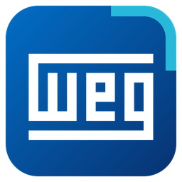
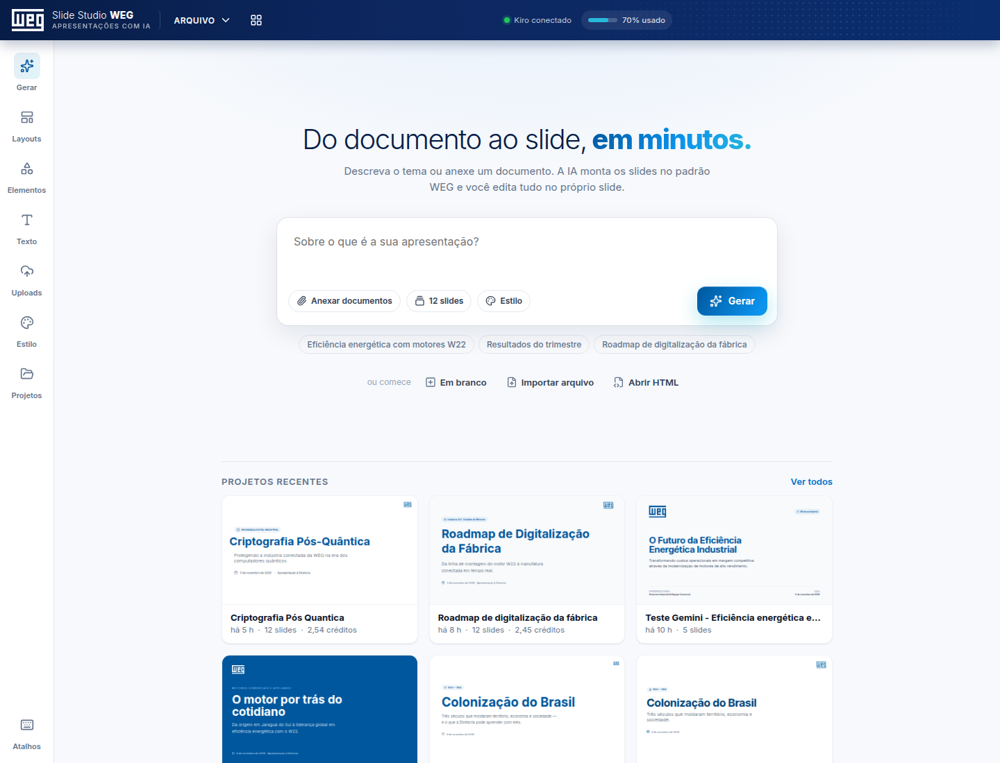
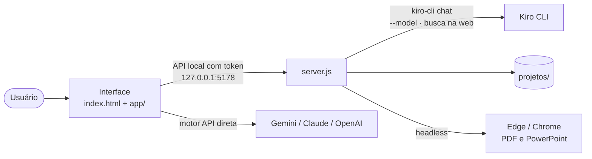

<div align="center">



# Slide Studio WEG

**Do documento ao slide, em minutos.**

Crie apresentações corporativas com IA e edite tudo direto no slide, no estilo Canva,
com a identidade visual da WEG por padrão.

[](LICENSE)
[](https://nodejs.org)
[](#como-abrir)
[](#motores-de-ia)



</div>

## Sobre

O Slide Studio WEG roda no seu computador. Você descreve o tema ou anexa documentos (PDF, Word,
PowerPoint, Excel...), a IA monta a apresentação seguindo o design system da WEG, e você ajusta
cada texto, ícone, imagem e forma no próprio slide. O resultado é um HTML autocontido que pode
ser apresentado em tela cheia, exportado em PDF ou PowerPoint, ou baixado.

> Esta é a v2. O README da v1 está em `_backup-v1/README.md`.

## Destaques

- 🤖 **Três motores de IA:** Kiro CLI (com escolha do modelo exato), API direta (Gemini, Claude,
  OpenAI) ou prompt para colar em qualquer IA.
- 🌐 **Busca na web:** o Kiro e o Gemini pesquisam dados atuais durante a geração, e o Gemini
  mostra as fontes consultadas.
- ✏️ **Editor visual:** arrastar, redimensionar, girar, alinhar, camadas, seleção múltipla,
  desfazer/refazer e guias de alinhamento.
- 🪄 **Editar slide com IA:** reescreva um slide só ("deixar mais conciso", "traduzir para
  inglês"...) sem mexer no resto.
- 📄 **Importa quase tudo:** PDF, DOCX, PPTX, XLSX, ODT, RTF, HTML, CSV, JSON e imagens.
- 📤 **Exporta para PDF e PowerPoint:** PDF em 1 clique e .pptx com textos editáveis.
- 🎨 **Identidade WEG pronta:** paleta, fonte e logo aplicados à apresentação inteira, com
  cerca de 2.000 ícones e busca em português.
- 🔒 **Privado por padrão:** servidor só local, com token, e chaves de API criptografadas.

## Sumário

- [Sobre](#sobre)
- [Destaques](#destaques)
- [Requisitos](#requisitos)
- [Como abrir](#como-abrir)
- [Fluxo de uso](#fluxo-de-uso)
- [Motores de IA](#motores-de-ia)
- [Editor](#editor)
- [Importar](#importar)
- [Exportar](#exportar)
- [Passar para outros PCs](#passar-para-outros-pcs)
- [Privacidade](#privacidade)
- [Limitações conhecidas](#limitações-conhecidas)
- [Estrutura do projeto](#estrutura-do-projeto)
- [Desenvolvimento](#desenvolvimento)
- [Licença](#licença)

## Requisitos

- **Node.js** (o servidor não tem dependências: não precisa de `npm install`).
- **Microsoft Edge** ou Google Chrome, para a janela do app e a exportação de PDF e PowerPoint.
- **Internet**: as apresentações usam Tailwind, Google Fonts e Lucide por CDN.
- **Kiro CLI** (opcional), para gerar com o motor Kiro. Sem ele, use o motor API ou Prompt.

## Como abrir

**Windows, com o atalho:** dê um duplo clique em **Slide Studio WEG** na Área de Trabalho.
O atalho roda o `iniciar.vbs`, que:

1. sobe o servidor local (`node server.js`) sem janela, se ele ainda não estiver rodando;
2. abre o app no Microsoft Edge em modo aplicativo: http://127.0.0.1:5178

Se o servidor não subir, aparece um aviso. O log fica em `servidor.log`, nesta pasta.

**Sem o atalho (Windows, Linux ou macOS):** abra um terminal nesta pasta e rode:

```bash
node server.js
```

Depois abra http://127.0.0.1:5178 no navegador. A porta pode ser trocada pela variável `SSW_PORT`.

> Abrir o `index.html` direto funciona em "Modo arquivo", mas sem Kiro, sem salvar
> projetos e sem PDF em 1 clique. Prefira sempre o servidor.

## Fluxo de uso

1. **Tela inicial:** descreva o que você quer na caixa de pedido (ou escolha uma sugestão),
   comece em branco, importe um arquivo ou abra um projeto recente.
2. **Gerar com IA:** anexe documentos no painel **Gerar**, escolha o motor e clique em **Gerar**.
   A tela de progresso mostra as etapas e as miniaturas sendo preenchidas. Ao terminar,
   a apresentação abre no editor.
3. **Editar** direto no slide (veja [Editor](#editor)).
4. **Apresentar** em tela cheia ou **Exportar** em PDF ou PowerPoint.

O projeto é salvo automaticamente na pasta `projetos/`. Projetos excluídos vão para
`projetos/_lixeira`.

## Motores de IA

O motor é escolhido no painel **Gerar**.

| Motor | Como funciona |
|---|---|
| **Kiro** (padrão) | O servidor envia o pedido ao Kiro CLI e abre o resultado no editor. O Kiro pode pesquisar na web. |
| **API direta** | Usa a sua chave do Google Gemini, Anthropic ou OpenAI. |
| **Copiar prompt** | Copia o prompt para colar em qualquer IA. Depois você cola o HTML gerado de volta no app. |

### Kiro

- **Modelo:** escolha o modelo exato na caixa **Modelo do Kiro**. A lista vem do próprio Kiro CLI
  e mostra quantos créditos cada modelo gasta (ex.: `claude-sonnet-5.5 · 1,3x créditos`).
  Com **auto**, o Kiro escolhe o modelo. A escolha fica salva e vale também para **Editar com IA**.
- **Busca na web:** o Kiro pode pesquisar dados atuais durante a geração. Ele só tem permissão
  para ler o pedido e pesquisar na web: não grava arquivos nem abre endereços arbitrários.
- **Créditos:** cada geração e cada edição de slide mostra os créditos gastos, que também aparecem
  no cartão do projeto. A barra superior mostra quanto do plano do Kiro já foi usado
  (clique para atualizar).

### API direta

- A chave fica criptografada neste computador (DPAPI do Windows).
- O modelo é escolhido do catálogo do provedor. Falhas temporárias são repetidas sozinhas.
- O Gemini pesquisa na web e mostra as fontes. Modelos de voz, imagem e vídeo ficam fora da lista,
  e um modelo sobrecarregado ou sem cota é trocado pelo próximo Flash do catálogo.

## Editor

### Seleção e edição

- **Clique** seleciona; **duplo clique** edita o texto no próprio slide.
- **Arraste** para mover (com guias de alinhamento). As alças nos cantos redimensionam e a alça
  de baixo gira.
- A **barra de contexto** muda conforme o elemento: texto (fonte, tamanho, cor, negrito,
  alinhamento, espaçamento, fundo), ícone (cor, tamanho, traço, trocar), imagem (trocar,
  ajustar, cantos, espelhar, sombra) e forma (preenchimento, borda, cantos, sombra).
- Transparência, camadas, alinhar à página, bloquear, duplicar e excluir. O clique direito
  abre o menu com essas ações.
- Cole imagens e texto (Ctrl+V) ou arraste imagens do computador para o slide.

### Vários elementos de uma vez

Shift+clique soma ou tira da seleção, arrastar no espaço vazio desenha um retângulo de seleção
e Ctrl+A seleciona tudo do slide. O grupo se move junto, e a barra mostra **Alinhar** (entre si
e à página), **Distribuir** com espaços iguais, transparência, camadas, bloquear, duplicar,
copiar/colar e excluir.

### Painéis e slides

- Painéis do trilho lateral: **Gerar**, **Layouts**, **Elementos** (formas e cerca de 2.000 ícones
  com busca em português), **Texto**, **Uploads**, **Estilo** (paleta, fonte e logo da marca
  aplicados à apresentação inteira), **Projetos** e **Atalhos**.
- Slides: adicione com layout, duplique, exclua e reordene arrastando a miniatura.

### Editar slide com IA

Com nenhum elemento selecionado, clique em **Editar com IA** na barra do slide (também no menu
da miniatura e no clique direito). Escreva o que mudar ou escolha uma sugestão ("Deixar mais
conciso", "Transformar em 3 tópicos com ícones", "Traduzir para inglês"...). A IA reescreve só
aquele slide, mantendo cores e fontes da apresentação, e o slide é trocado inteiro.
Se não gostar, clique em **Desfazer** no aviso ou use Ctrl+Z.

Usa o mesmo motor (e, no Kiro, o mesmo modelo) escolhido no painel Gerar. Scripts e códigos
inseridos pela IA são removidos antes de entrar no slide.

### Atalhos do teclado

| Ação | Atalho |
|---|---|
| Desfazer / Refazer | Ctrl+Z / Ctrl+Y |
| Salvar | Ctrl+S |
| Copiar / Colar / Duplicar | Ctrl+C / Ctrl+V / Ctrl+D |
| Excluir elemento | Delete |
| Selecionar vários | Shift+clique ou arrastar no vazio |
| Selecionar tudo no slide | Ctrl+A |
| Editar texto | Duplo clique ou Enter |
| Sair da edição / seleção | Esc |
| Mover 1 px / 10 px | Setas / Shift+Setas |
| Manter proporção ao redimensionar | Shift |
| Mover sem encaixe | Alt |
| Selecionar item dentro do grupo | Alt+clique |
| Slide anterior / próximo | PageUp / PageDown |
| Zoom | Ctrl + / Ctrl − / Ctrl 0 |
| Negrito / Itálico / Sublinhado | Ctrl+B / I / U |
| Bloquear elemento | Ctrl+L |
| Apresentar | F5 |

## Importar

| O quê | Formatos | Resultado |
|---|---|---|
| Documentos para a IA | PDF, DOCX, PPTX (com notas), XLSX, ODT, ODP, ODS, RTF, HTML, TXT, MD, CSV, JSON | O texto entra no pedido para a IA |
| PDF como slides | PDF | Cada página vira um slide |
| Apresentação existente | HTML | Abre no editor |
| Imagens | PNG, JPG, WebP, SVG etc. | Vão para Uploads, já redimensionadas |

## Exportar

- **Exportar PDF** (1 clique): o servidor gera o PDF com o Edge em segundo plano, uma
  página 16:9 por slide e texto selecionável. Se falhar, abre a janela de impressão.
- **PowerPoint (.pptx)**, no menu ao lado do botão: cada slide vira uma imagem de fundo em alta
  resolução com **caixas de texto editáveis** por cima, na mesma posição, cor e tamanho.
  Formas, ícones, imagens e degradês ficam no fundo (não editáveis). Textos girados ou com
  degradê também ficam no fundo. Há também a opção **só imagens**.
  O .pptx não leva fontes da web: se a fonte da apresentação (ex.: Inter) não estiver instalada
  no computador, ela é trocada pela instalada mais parecida (ex.: Segoe UI) e o aviso informa.
- **Baixar HTML** da apresentação (sem as marcações do editor), no mesmo menu.
- O prompt (.md) fica no menu **Arquivo**.

## Passar para outros PCs

Envie o arquivo **`dist/Slide Studio WEG.zip`**: ele tem o `Slide Studio WEG.exe` e um LEIA-ME.
A pessoa extrai o zip e dá dois cliques no .exe. O app abre numa janela própria, sem instalar nada
(o Node, o servidor e a interface vão dentro do .exe).

- Requisitos no outro PC: Windows 10/11 com Microsoft Edge (já vem no Windows) e internet.
- Na primeira vez o Windows pode mostrar "O Windows protegeu o computador", porque o .exe não tem
  assinatura digital paga. Clique em **Mais informações** e depois em **Executar assim mesmo**.
  Antivírus corporativo pode bloquear programas sem assinatura.
- Sem o Kiro, a geração usa o motor **API** com a chave da própria pessoa (o Google Gemini tem cota
  gratuita) ou o motor **Prompt**. Editor, edição com IA, PDF e PowerPoint funcionam normalmente.
- As apresentações ficam em **Documentos\Slide Studio WEG**. Configurações e chaves ficam no perfil
  da janela, em `%LOCALAPPDATA%\SlideStudioWEG`.
- Fechar a janela encerra o programa (cerca de 1 minuto depois).
- Na primeira abertura o app cria o atalho **Slide Studio WEG** no Menu Iniciar. É ele que deixa o
  ícone nítido na barra de tarefas (a janela é do Edge, que entrega um ícone de 32 px que o Windows
  borra ao reduzir para 24 px). Por isso o ícone fica nítido a partir da segunda abertura.

## Privacidade

- Tudo roda no seu computador. O servidor só aceita conexões locais (127.0.0.1) com token.
- O conteúdo sai da máquina apenas para a IA escolhida (Kiro ou o provedor da API direta), e o app
  pede autorização antes de enviar, listando os documentos anexados.
- As chaves de API ficam criptografadas em `%LOCALAPPDATA%\SlideStudioWEG`.
- Os slides não podem abrir conexões de rede (CSP).

Detalhes da auditoria de segurança e confiabilidade: `ANALISE-AUDITORIA.md`.

## Limitações conhecidas

- Editor, miniaturas e PDF precisam de internet (Tailwind, Google Fonts e Lucide vêm por CDN).
- PDF escaneado (só imagem) não é lido pela IA, porque não há OCR. Use "PDF como slides".
- Formatos antigos (.doc, .ppt, .xls) não são lidos. Salve como DOCX, PPTX, XLSX ou PDF.
- No editor o slide aparece parado (sem animações e contadores). As animações aparecem em
  Apresentar.
- F5 com o foco dentro do slide pode abrir sem tela cheia (o navegador só permite tela cheia
  a partir de um clique). O botão **Apresentar** sempre abre em tela cheia.
- No PowerPoint exportado, só os textos são editáveis. O resto do slide é a imagem de fundo.
- Seleção múltipla não redimensiona nem gira o grupo (faça um elemento por vez).

## Estrutura do projeto

| Caminho | Função |
|---|---|
| `server.js` | Servidor local: Kiro (geração, modelos, créditos), projetos, exportação PDF e PowerPoint |
| `pptx.js` | Gerador do arquivo PowerPoint (.pptx) |
| `index.html` | Estrutura da interface |
| `app/` | Código do app (editor, importadores, estilos, painéis) |
| `app/ai.js` | Cliente dos provedores de IA da API direta (novas tentativas, prazo, catálogo de modelos, busca) |
| `app/vendor/` | Bibliotecas locais |
| `iniciar.vbs` | Inicializador usado pelo atalho no Windows (servidor + Edge) |
| `ferramentas/gerar-exe.js` | Gera o `dist/Slide Studio WEG.exe` e o `.zip` para outros PCs |
| `ferramentas/icone-barra.ps1` | Deixa o ícone nítido na barra de tarefas do Windows |
| `dist/` | Executável e zip para distribuir |
| `docs/` | Imagens usadas neste README |
| `projetos/` | Suas apresentações salvas (`_lixeira/` não vai para o Git) |
| `agente-base.md` | Regras de geração e tokens do design system WEG |
| `ANALISE-AUDITORIA.md` | Parecer sobre a auditoria e o que foi corrigido |
| `STATUS-PRODUCAO.md` | O que está pronto e o que falta |
| `NOTAS-DESENVOLVIMENTO.md` | Notas técnicas |
| `_backup-v1/` | Versão anterior |
| `LICENSE` | Licença MIT |
| `.gitignore` | Arquivos fora do Git: `servidor.log`, `projetos/_lixeira/`, `.env`, arquivos de sistema e de editores |

## Desenvolvimento

### Arquitetura



1. A interface monta o prompt com o pedido, os anexos e o estilo escolhido.
2. No motor Kiro, o `server.js` grava o prompt numa pasta do projeto e roda o `kiro-cli chat`
   com o modelo escolhido. O Kiro só tem permissão para ler o prompt e pesquisar na web.
3. O servidor captura o HTML da resposta, salva em `projetos/<id>/presentation.html` e a
   interface abre o resultado no editor.
4. No motor API direta, a própria interface chama o provedor (`app/ai.js`), sem passar pelo Kiro.

### Rodar e alterar

- Rodar localmente: `node server.js` e abrir http://127.0.0.1:5178.
- Os arquivos de `app/` e o `index.html` são lidos a cada acesso: basta recarregar a página.
  Mudanças no `server.js` pedem reiniciar o servidor.
- Gerar o .exe de novo depois de mudar o código: `node ferramentas/gerar-exe.js`.
- O `servidor.log` é recriado a cada inicialização e não é versionado.

## Licença

Distribuído sob a licença MIT. Veja o arquivo [`LICENSE`](LICENSE).

© 2026 Junior Antunes
